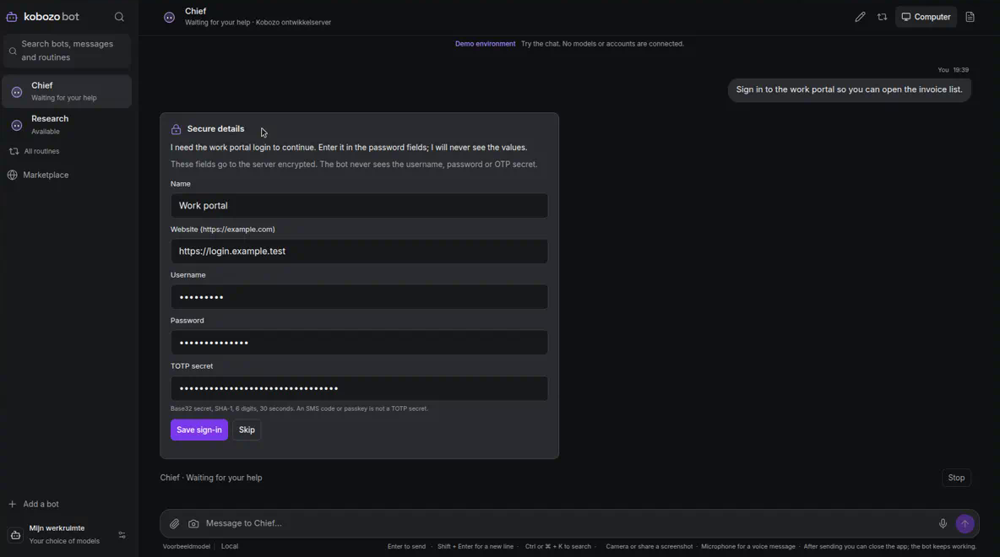
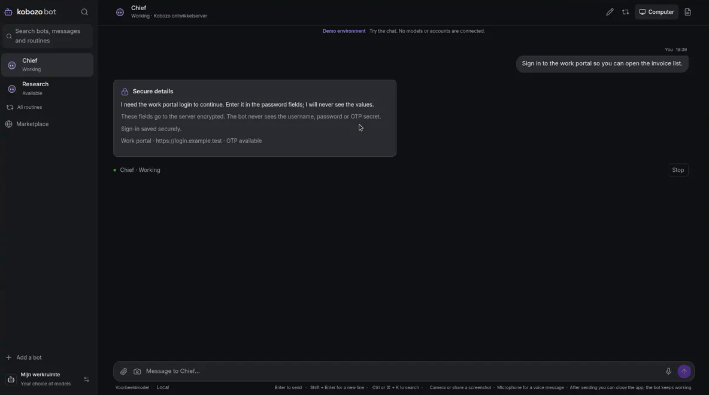

# Computers and desktops

Each bot can have a persistent Debian desktop (Chrome, Thunar, xterm) on its
project computer. **Computer** in the header opens that session. View-only is
enforced by the VNC server; taking control pauses new agent input.

Right-click the computer toolbar or the window frame for Terminal, Files,
Chrome, take or release control, reconnect and close. A right-click on the
picture itself goes to that desktop and does not open this menu.

Closing the Mac or browser client does not stop the backend. Bots in a project
share `/workspace` and keep separate browser profiles.

## When the bot needs you

If the bot cannot continue on its own, chat shows a screenshot with **Take over**
or **Skip**. Take over opens the desktop so you can finish the step yourself.
When you are finished, **Done, handover to bot** at the top of that window sends
a chat message that the screen is back with the bot. Closing the window leaves
the request pending. The next agent step needs a fresh screen.

## Teach

**Teach** records a human demonstration on the bot desktop. Sign-ins use a
separate encrypted store. When a bot needs a login, chat can show password
fields for the username, password and optional one-time-code secret. Those
values never appear in the conversation. The bot can then ask the server to
paste the username, password or current one-time code into the focused field
on its desktop. If nothing is stored yet, it asks you with that form instead
of typing the secret into chat.

*Demo capture: Chief waiting for a work-portal login. Username, password and
TOTP are password fields. Those values never appear in the conversation.*

*Demo capture: the card confirms the encrypted save. Only the label, website
and whether OTP exists are shown.*

You can still open **Computer → Sign-ins** to save or insert values while you
have control. Secrets are not returned to the model. The form is the same
stacked fields on a phone, so no separate mobile shot is included.

## Limits

Computer control requires a model with validated vision and tool support.
For a model connected under **Model keys**, an administrator turns on
**Own desktop** on that model. Chat keeps working when the box is off; the bot
then has no Chrome or screen tools, so it never opens its project LXC. With the
box on, the next task can operate that bot’s own desktop. Chat-only runs are
shorter than computer runs. LXC projects share the host
kernel; they are not VM-level isolation. Shared browser profiles between bots
are not implemented.

## Office network printers

An administrator can allowlist IPP/IPPS office printers under
**My workspace → Network printers**. When enabled, computer-capable bots get
`computer_print` for files under `/workspace` on those queues only. USB printers
attached to your laptop are not forwarded into the bot desktop.

## Passkeys and security keys in the bot browser

Kobozo account passkeys (sign-in to your server) are separate from passkeys or
hardware keys used on websites inside a bot’s Chrome. In the Mac app, open
**My workspace → Computers** and optionally enable **Use passkeys and security
keys for bot browsers** (off by default). The Computer window can then show a
consent prompt when the bot browser asks for a passkey or security key. Completing
those ceremonies on your Mac is not finished yet. Until then, when a site asks
for MFA or a passkey, use **Take over** on the Computer window and complete the
step yourself, then **Done, handover to bot**.

## Terminal on a local install (preview)

This applies only to a Kobozo Bot server running in local mode on one computer,
and it is a preview. A bot has no terminal until you switch it on: open the bot
in **Edit agent**, turn on **Terminal for this bot (preview)** and confirm that
you understand it is not isolated. It needs the `herdr` program on the computer;
without it the bot is told that herdr was not found.

The terminal runs as your own user on that computer. It is not isolated: the bot
can read other bots' files and anything else your user can read, so only turn it
on for a bot you trust. You can watch it with `herdr --session <name>` on that
computer (the name is in the server's startup log). Typing in the bot's pane
does not pause the bot yet.
