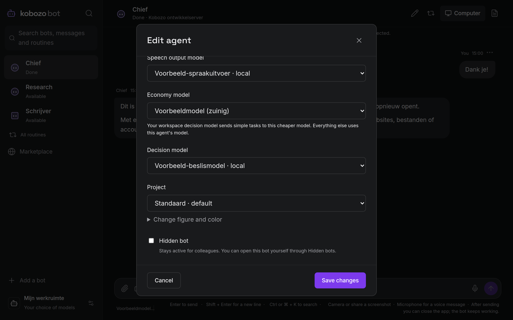
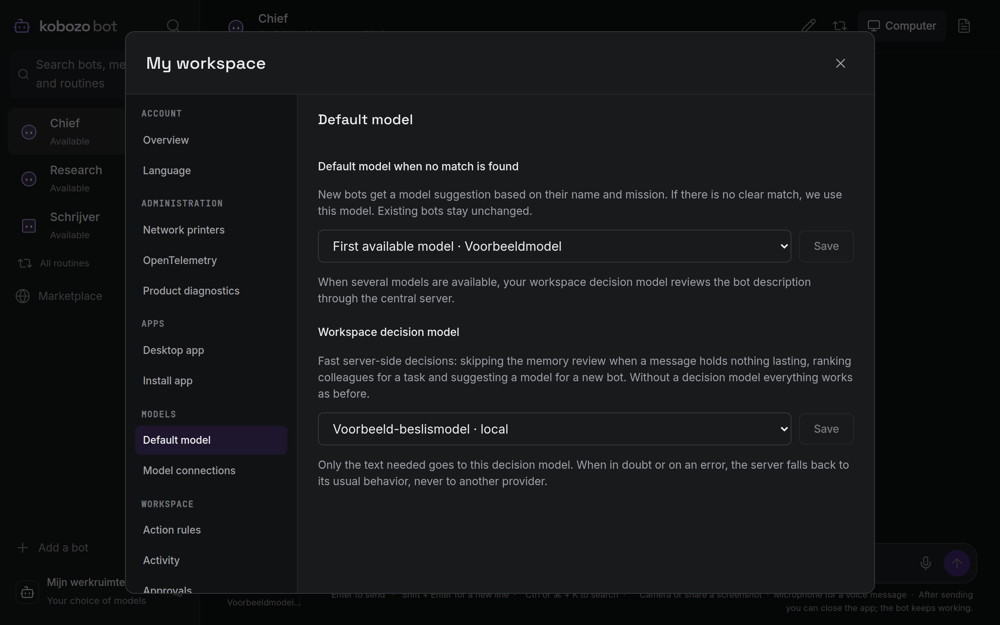
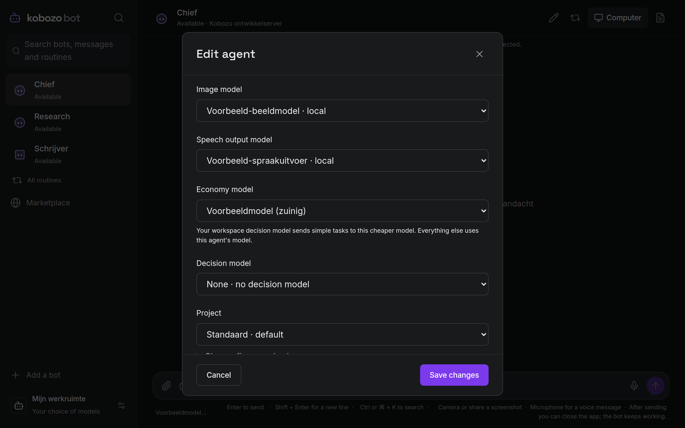

# Decision models (Jev, LAYA)

A decision model gives a bot fast, calibrated judgments: which option fits, where
something sits on a scale, or how likely a yes/no condition is. It never writes
text and never replaces the bot's chat model. The bot uses it for narrow calls
such as routing a request, triaging a ticket, scoring a lead or checking whether
a message asks for a refund, and still writes its own answer.

Two kinds are supported:

- **Jev** from TypeSafe, an online API. Your administrator pastes a TypeSafe key.
- **LAYA**, which you run yourself on your own server or network, set up like
  vLLM or Ollama. Your administrator enters its local address and, if your LAYA
  server requires one, a key. LAYA stays available in workspaces that allow local
  models only.

## Connect a decision model (administrator)

Open **My workspace → Model keys → Company keys**. The cards under **Decision
models** are **TypeSafe** (Jev) and **LAYA**.

- **TypeSafe**: paste the API key from the TypeSafe console. **List models**
  shows the available Jev versions. Keep a fixed version from that list
  once a workflow depends on it; a `latest` alias moves with every release.
- **LAYA**: enter the address of your LAYA server, for example
  `http://10.0.0.8:9000/v1`. Only local network addresses are accepted. If the
  server cannot list its models, add the served model name by hand.

Decision models are not offered in the setup wizard or as personal keys.

## Choose a decision model for a bot

Open **Edit agent** (the pencil beside the bot name). Once your server has a
decision model, **Decision model** appears below the image and speech output
models. Choose one, or `None`.

*Demo capture: Chief with the labeled demo decision model selected.*

A bot without a decision model simply does not have this tool. It never falls
back to another provider.

## Workspace decision model

Under **My workspace → Models → Default model**, **Workspace decision model**
lets the server use a decision model for its own quick judgments, separately
from any bot. Today it decides whether a message holds anything worth
remembering; if clearly not, the extra memory review by the chat model is
skipped, which saves a model call per message.

The same workspace decision model also helps a coordinating bot, such as a
Chief of Staff, pick the right colleague. Before it hands out a task, it can
rank the available colleagues by how well their role fits. When the ranking is
clear it asks that colleague; when it is not, it asks you which colleague to
use. Your own choice always wins. **Details** shows **Colleague choice** with
the chosen name.

When you create a bot from a template or let a bot create one, the workspace
decision model also suggests the model that best fits the new bot's role,
instead of an extra call to your default chat model. If no model clearly fits,
the bot gets your default model.

*Demo capture: the default model and the demo decision model selected for the
workspace.*

## Cheaper model for simple tasks

In **Edit agent**, **Economy model** lets you pick a second, cheaper model for
the bot. With a workspace decision model selected, every task is first judged:
a greeting, a thank-you or a short, well-defined request runs on the economy
model; anything else runs on the bot's own model. One model handles the whole
task; it never switches halfway. When in doubt, or when the cheaper model lacks
something the task needs (such as reading images), the bot's own model is used.
**Details** shows **Economy model used** or **Model ladder: main model used**.

Only you set the economy model. A bot cannot set it for itself or a colleague.

## Quieter routine notifications

With a workspace decision model, a routine result that clearly holds nothing new
does not send a notification; it stays in the chat. Everything else still
notifies you. See [routines](integrations-and-routines.md#fewer-notifications-for-routine-results).

*Demo capture: a bot with a cheaper economy model next to its own model.*

## What you see

Ask the bot as usual, for example "Sort these five support mails by team and
urgency". When it consults the decision model, **Details** shows **Decision model
consulted**. The bot reports the result as a judgment with its probability, and
asks you when the model is not confident.

## Limits

- Up to 32 questions and about 60,000 characters of material per call (about
  120,000 characters including the questions); one call
  has 30 seconds. On a timeout or overload the bot tells you instead of retrying
  elsewhere.
- Jev is strongest in English. Dutch and French work with lower accuracy.
- What the bot sends to Jev goes to TypeSafe's cloud. Use LAYA when the material
  must stay on your own network.
- Demo mode offers **Voorbeeld-beslismodel**. Its answers are equal
  probabilities with zero confidence: an example of the flow, not a judgment.
  Select it for a demo bot and ask it to judge or sort something to see it run.
