# Your first team

Open the orchestrator in a browser. On a wide window the bot list stays beside
chat and the conversation uses the available width. On a phone you start on the
list, then open one bot. The search control on the list, or **Ctrl+K** / **⌘K**,
opens the same account-scoped palette.

Right-click an empty part of the team list to open the list menu: **New project**,
**Add a bot**, **Marketplace**, **Search**, **All routines** and **My workspace**.
Hidden and archived bots appear in that menu when you have any. Right-click a
bot for that bot’s own actions. When more than one sandbox exists, right-click
a project name for rename, security, updates, start and remove.

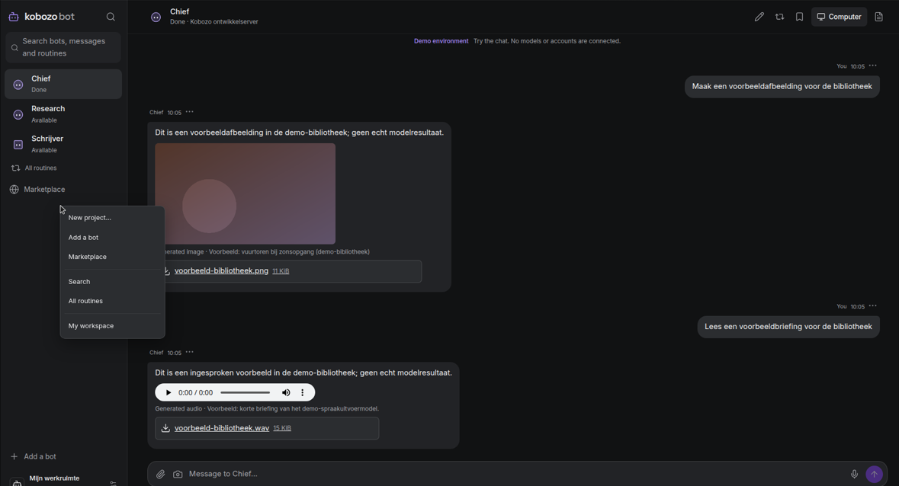

*Demo capture: right-click on empty space in the team list. **New project**
creates a sandbox and leaves each bot in its current project.*

Right-click an empty part of the conversation for the actions that belong to
chat: write a message, edit the agent, Computer, Routines, Skills, Details,
search and My workspace. Right-click a message to reply, forward or unsend.
Text fields and links keep the browser menu, so copy, paste and spelling stay
available. The same idea is used on Details, dialogs, search and the computer
toolbar. A right-click on the computer picture itself stays with that desktop.

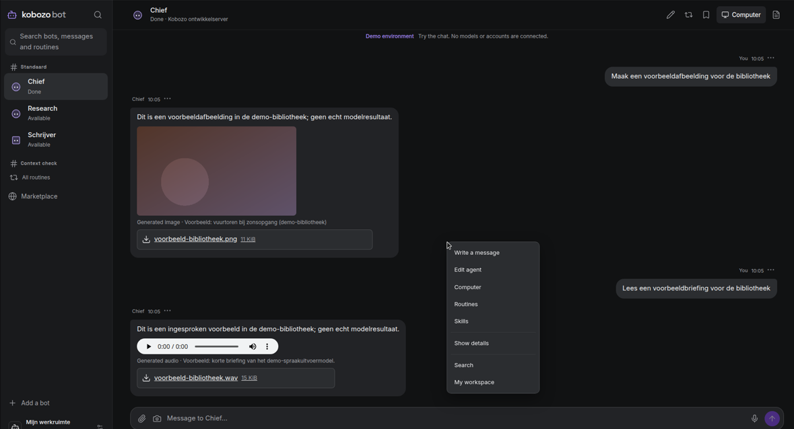

*Demo capture: right-click on the conversation background. The menu belongs to
that chat: write a message, edit the agent, Computer, Routines, Skills, show
or hide Details, search and My workspace.*

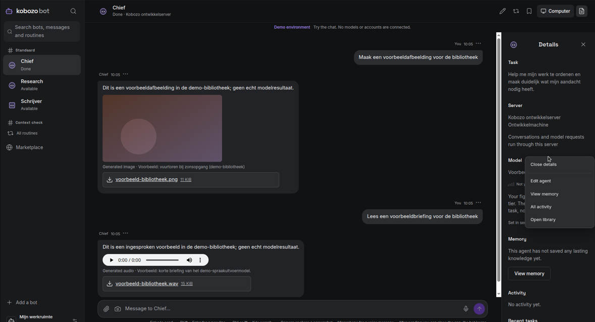

*Demo capture: right-click on empty space in Details. Close the panel, edit
the agent, view memory, open all activity or open the library.*

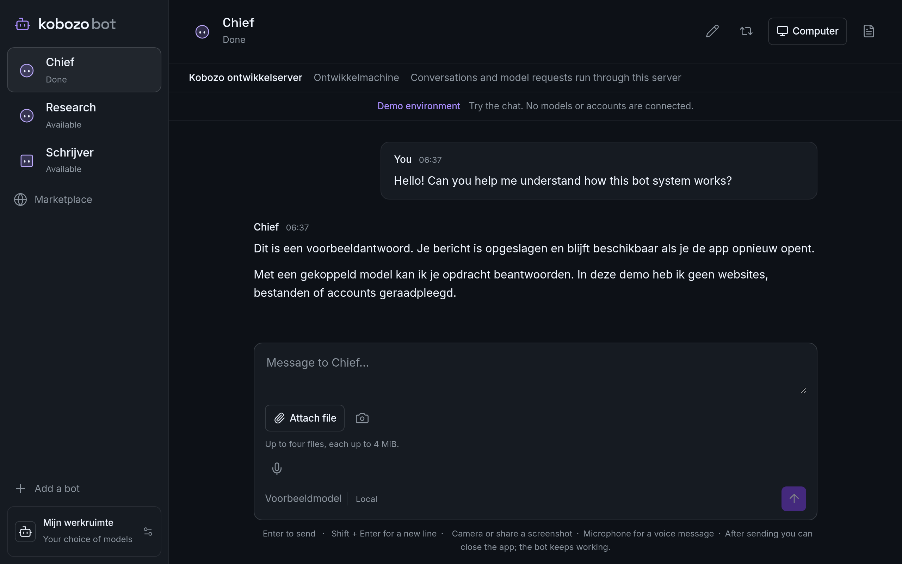

*Demo capture: team list, chat and composer. The demo banner means no models or
accounts are connected.*

## Add or edit a bot

**Add a bot** opens a chat with a new, empty colleague. It has no name or task
yet. Tell it what you need it to do. It asks until that role is clear, then
gives itself a name from the work. Naming is behind the scenes: the answer stays
on the role, the team list picks up the name, and **Details** records that it
chose a name. You do not have to name it. If you do give a name, it keeps that
one. If you ask it to give itself a name, that name replaces the placeholder in
the team list and in the chat header. If you add a routine before that task exists, the instruction you save for
the routine also becomes the bot’s task. A task that is already filled stays as
it is. The pencil beside the name still opens **Edit agent** when you want to
change those yourself. Name, task and model are saved together and apply to
later work. You cannot change the model for a single message.

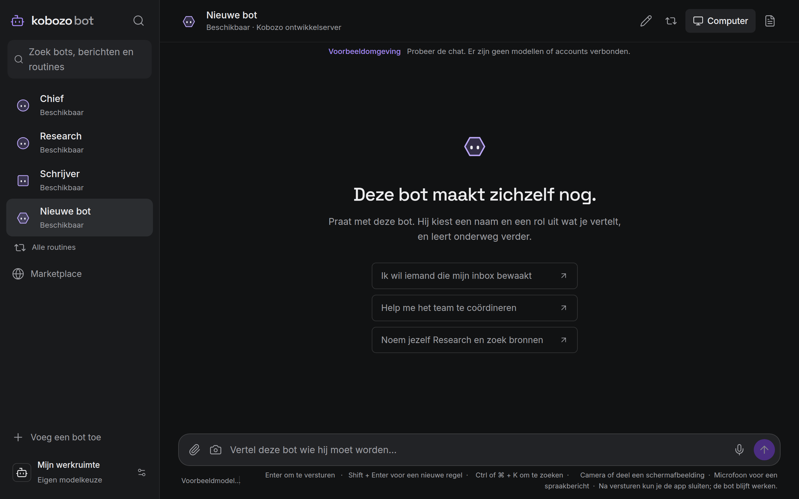

*Demo capture: **Add a bot** opens this empty chat. There is no name or task
form. Suggestion chips ask what the bot should do. The bot names itself after
that, behind the scenes.*

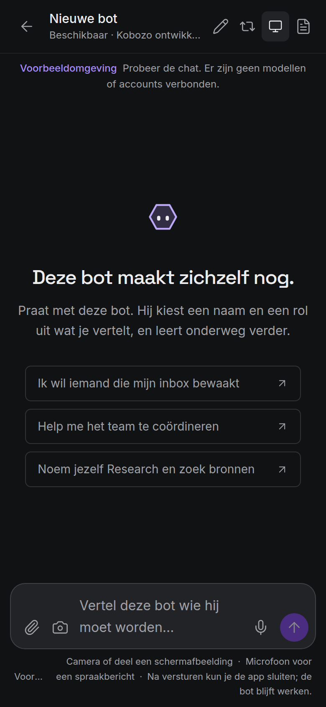

*Demo capture: the same empty chat on a phone. The team list is behind the back
control.*

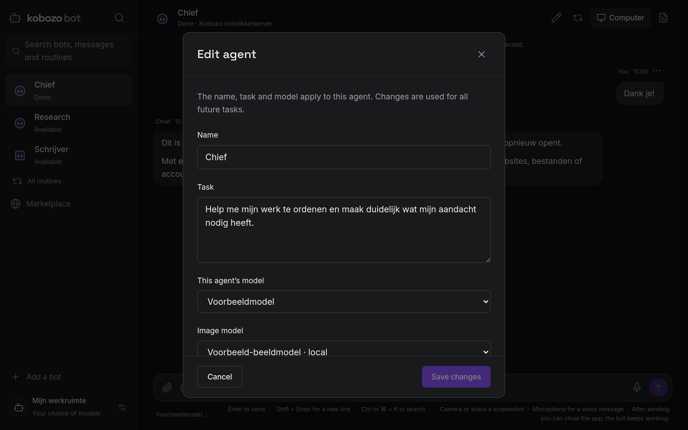

*Demo capture: editing a formed bot. Appearance can be changed separately from
the model.*

## How a bot behaves

The task a bot takes from that interview, or that you save in **Edit agent**, is its role:
it decides what the bot is for, and it stays the same across every conversation,
routine and helper request. The way a bot talks is the same for every bot. It
answers in your language, leads with the result, keeps short answers short, and
says in one line what it could not do instead of working around it.

A bot never reports an action as done before the tool that performs it succeeded, so
"sent", "saved" or "connected" in an answer means it actually happened. Anything the
bot reads along the way, such as a web page, a file, a screenshot or a connector
response, is treated as information and never as an instruction, even when that text
tells the bot to do something. Before sending a message, buying something, deleting
data or changing an account, the bot asks you first unless you already allowed it in
that conversation.

## Search

On a wide window press **Ctrl+K** or **⌘K**. Type a bot name, a phrase from an
old message, a routine name or a file name. Hidden bots appear in the results
without opening **Hidden bots**. Choosing a message opens that conversation;
choosing a routine opens **Routines**.

On a phone, use the search field on the bot list. The same results appear.

Search stays inside your account. Demo mode only searches the example
environment. Voice recordings and desktop files are not searched; the
transcript of a voice message is.

## Chat, files and voice

Type in the composer and send. The paperclip attaches up to four files, 4 MiB
each; limits appear in its tooltip and again when files are selected. On a phone
the camera button or Android Chrome share-into-app can add a photo. Record a
short voice message (up to 60 seconds) when a speech model is configured; demo
mode uses a labeled example transcript.

Useful answers stay in chat. Tool traces and status belong in **Details**. The
header shows the server name; location and the explanation of server-side model
calls are in Details.

Right-click a message, or use the options button on the balloon, to reply,
forward it, or unsend it. On a phone, press and hold the message. A choice with
several targets, such as which bot receives a forward, opens a window. The
context menu itself stays a short list.

Right-click a bot in the team list for the same kind of menu. **Add to project**
opens a window with the other projects and **New project…**. Rename, Edit,
Computer, Routines, Skills, Hide, Archive and Delete stay in the menu.

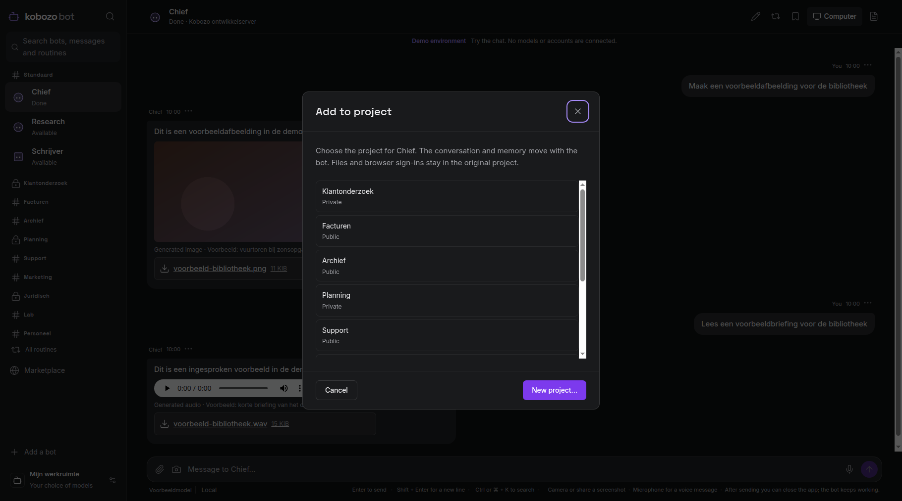

*Demo capture: Add to project stays a window. The project list scrolls inside
it. The context menu does not grow with the number of projects.*

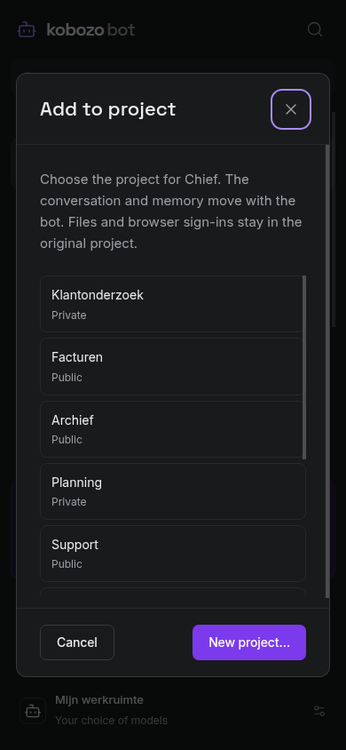

*Demo capture: the same window at phone width. The list scrolls inside the
window and the actions stay on screen.*

Reply quotes that moment and sends your new text with it. If you reply to an
open question, the bot treats your message as the answer to that question. When
several questions are open, pick one in the window first.

Forward opens a window and sends the text to the bot you choose. Files, voice
and generated pictures stay in the original chat.

Unsend works only on your latest own message. That message and everything after
it in this chat disappear, and a task that started there stops. Saved memory
stays.

## Details and memory

Open the document icon in the header. **Details** shows the bot's picture,
name and a short role (the first sentence of its task), then two tabs.

- **Activity** has a **Scheduled** card with this bot's routines (schedule in
  plain words, an on/off switch, five shown and **Show more** for the rest, or
  a button to open Routines when there are none), a **Computer** card that
  shows whether the computer is not set up, not active or active and opens the
  Computer window, an **About this bot** card (task, server, model, budget,
  memory, recent tasks, **All activity**) and **Recent activity**.
- **Library** shows the images and audio this bot made, with **Open library**
  for the full list.

**View memory** edits what the bot keeps across sessions. If a card cannot
load, it says so in one sentence and the rest of the panel keeps working.

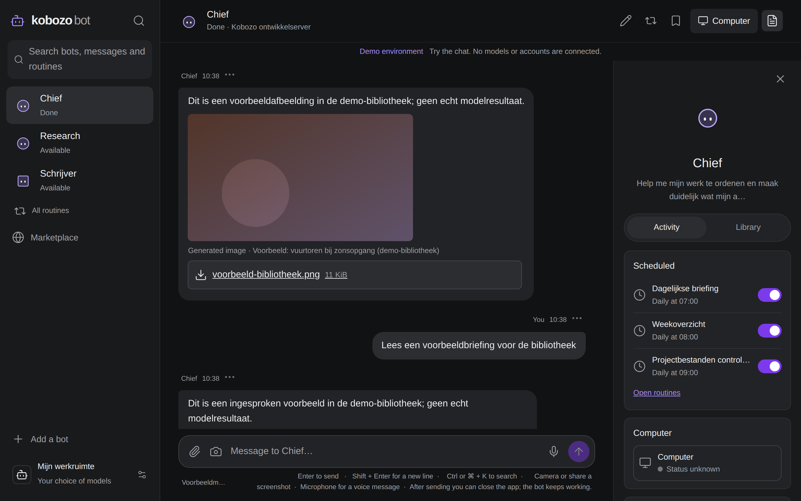

*Demo capture: Details for Chief on desktop, Activity tab with three example
routines. The demo has no project computer, so the Computer card shows
"Status unknown"; on a real install it shows the actual state.*

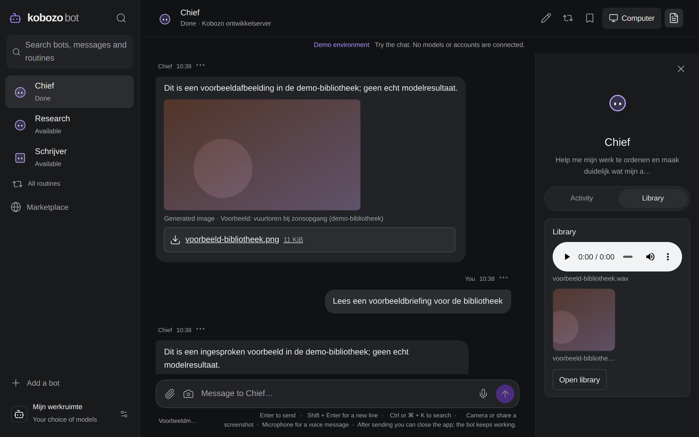

*Demo capture: the Library tab with the labeled example audio and image.*

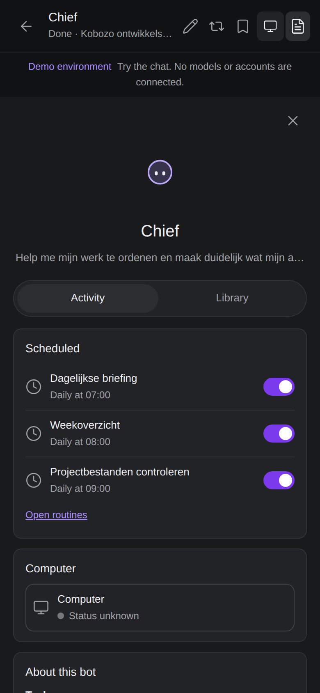

*Demo capture: on a phone, Details fills the screen; Back to bots keeps your
draft.*

Bots can stay hidden from the main list and still work. Open **Hidden bots** to
chat with them. Asking a colleague sends a bounded task; it is not a shared
group transcript. Group rooms are not implemented.

In the bot editor, **Accepts requests from colleagues** lets other bots call
this specialist. **Ask only selected specialists** limits which colleagues this
bot may invoke. Both sides must allow the call. Only you can change those two
settings. A bot cannot. When a colleague helps, the
parent chat shows a specialist result card with status, a short summary and an
**Open chat** link into that specialist’s conversation (your account only).

## Language

English is the default. Choose **My workspace → Account → Language** for English
or Nederlands. Bot names and instructions stay as written.
