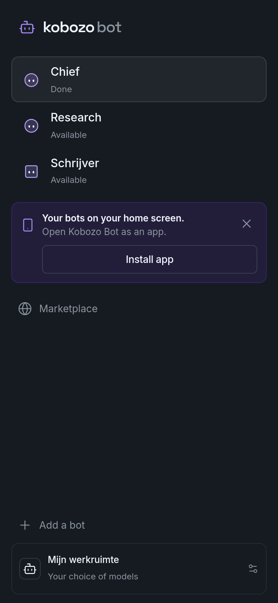
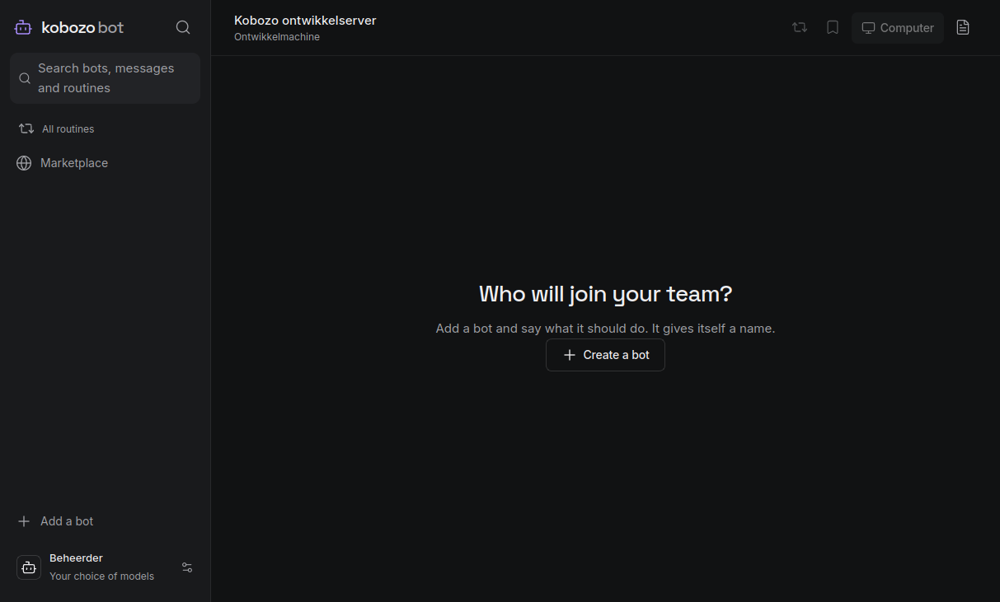
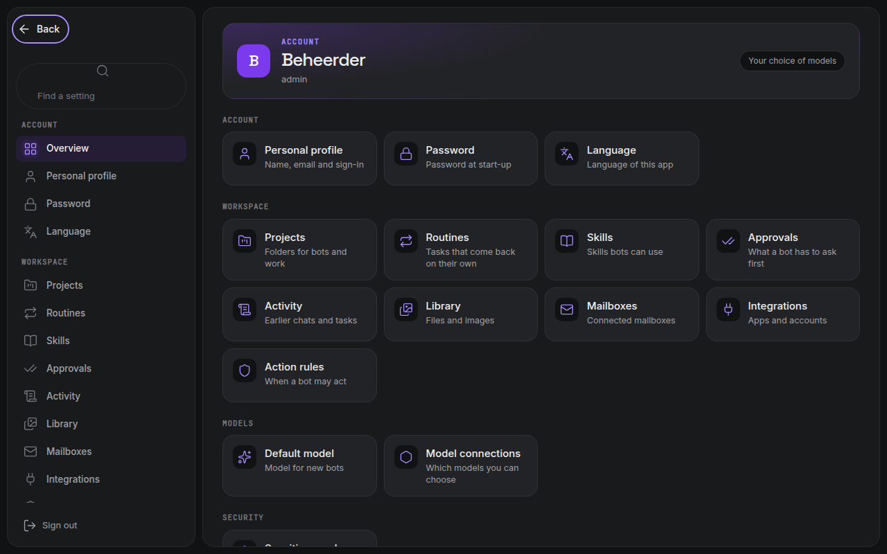
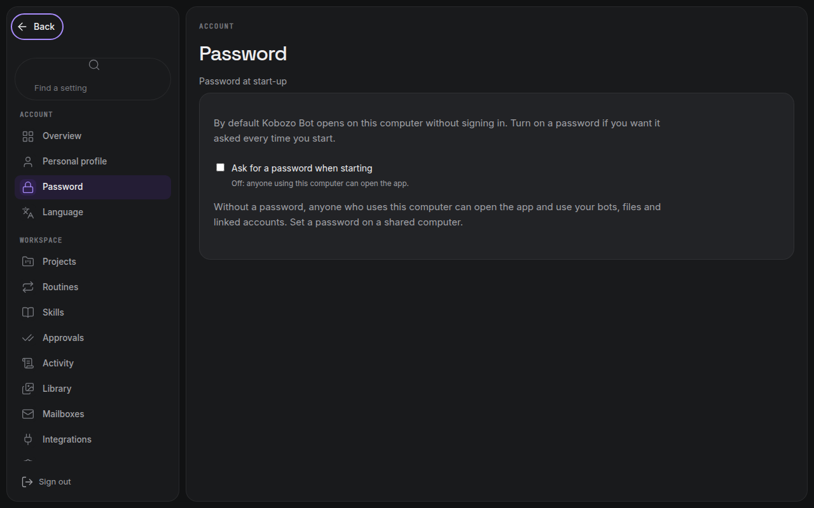
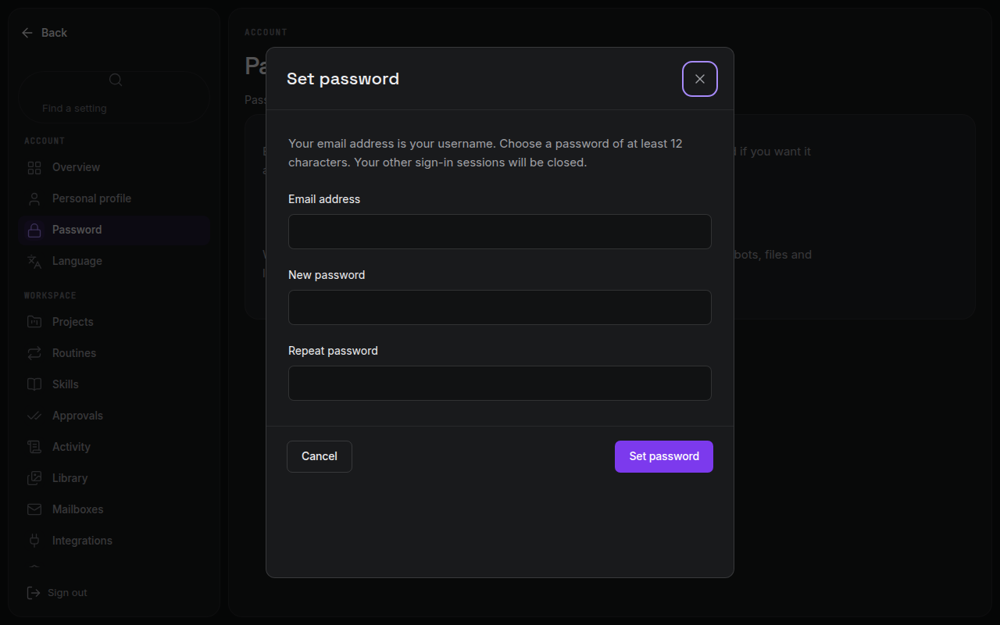
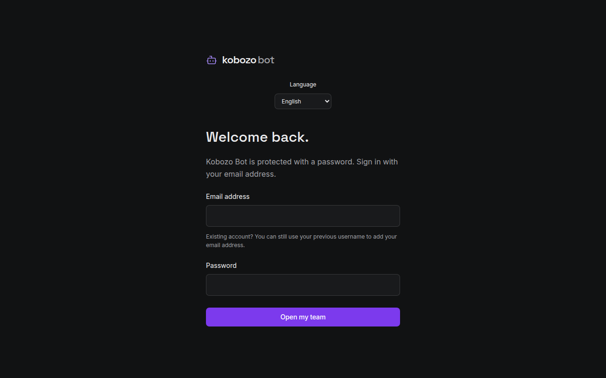
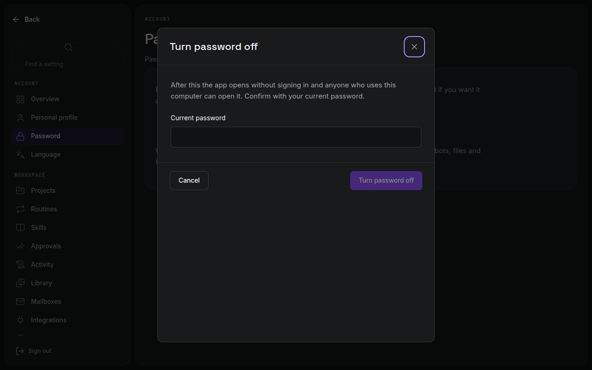

# Mac and phone

## Phone web app

Open the orchestrator’s **HTTPS** address on your phone. On a narrow screen you
see the bot list first. Opening a bot keeps an unsent draft if you go back.



*Demo capture: phone-width bot list, marketplace, add-bot and the install-app
notice.*

The search field on this list opens the same palette as **Ctrl+K** on a wide
window: bots, hidden specialists, messages and routines.

**Install app** appears on sign-in and on the list. Supporting browsers offer a
button; on iPhone use Safari **Share → Add to Home Screen**. The installed app
keeps this server. Chatting still needs a connection; the bot keeps working if
you leave.

## Mac app

The Mac app requests microphone permission when you record a voice message.
Its permission prompt explains that the recording is sent to your bots.

Download the universal ZIP from the same preview release (macOS 13+, Intel and
Apple Silicon). This preview is not Apple-notarized; macOS may ask for extra
permission to open it. Once your server offers the download, later server
updates keep it available until a newer Mac build replaces it.

**My workspace → Desktop app** copies the server URL. Sign in with the same
account. Closing the window does not stop the server. Personal settings stay
in the Mac app. **Organization settings** opens this server in the system
browser.

**My workspace → Computers** (Mac app only) can enable passkeys and security
keys for bot browsers. That setting is off by default and is separate from
**My account → Passkeys**. Forwarding those ceremonies is not finished yet;
use **Take over** on the Computer window when a site asks for MFA.

```text
kobozo-bot://connect?server=https%3A%2F%2Fyour-server
```

That link carries only the origin, never a password or session.

## Linux app (preview)

The Linux app runs Kobozo Bot on your own computer. It carries its own copy of
Node and the server, so there is nothing else to install, and it needs no
Proxmox. It is for 64-bit Ubuntu or Debian (Intel or AMD).

Install it from a release that includes the Linux app:

```bash
curl -fsSL https://github.com/kobozo/kobozo-bot-releases/releases/latest/download/install.sh -o install.sh
bash install.sh --local
```

The installer downloads the app of that release, checks its SHA-256 against the
value inside `install.sh`, and installs it with `apt` (it asks for your sudo
password when you are not root). Then open **Kobozo Bot** from your
applications menu, or run `kobozo-bot`. If a release has no Linux app, the
installer says so and installs nothing. Not every release has one yet: a
release has the Linux app only when its build succeeded.

We have installed and run the app with this installer on a clean Ubuntu 26.04
machine. The AppImage is not part of the release.



*Lab capture on Ubuntu 26.04: the app opens straight into your workspace, with
no sign-in.*

- **No login by default.** The app starts a private server on `127.0.0.1`, so
  only this computer can reach it, and signs you in by itself. There are no
  organization settings: everything is yours, under **Personal**.
- **One window.** Closing the window quits the app and stops the server. Start
  it again and your bots and data are still there
  (`~/.local/share/be.kobozo.bot`). A second start brings the first window to
  the front.
- **Optional password.** Open **My workspace → Password** and switch it on. You
  choose an e-mail address and a password of at least 12 characters. From then
  on the app shows a sign-in screen at start. Switching it off needs the current
  password. Set a password on a computer that other people use.



*Lab capture: no Organization switch, the Password page sits under Account.*



*The password is off: the app signs in by itself.*






