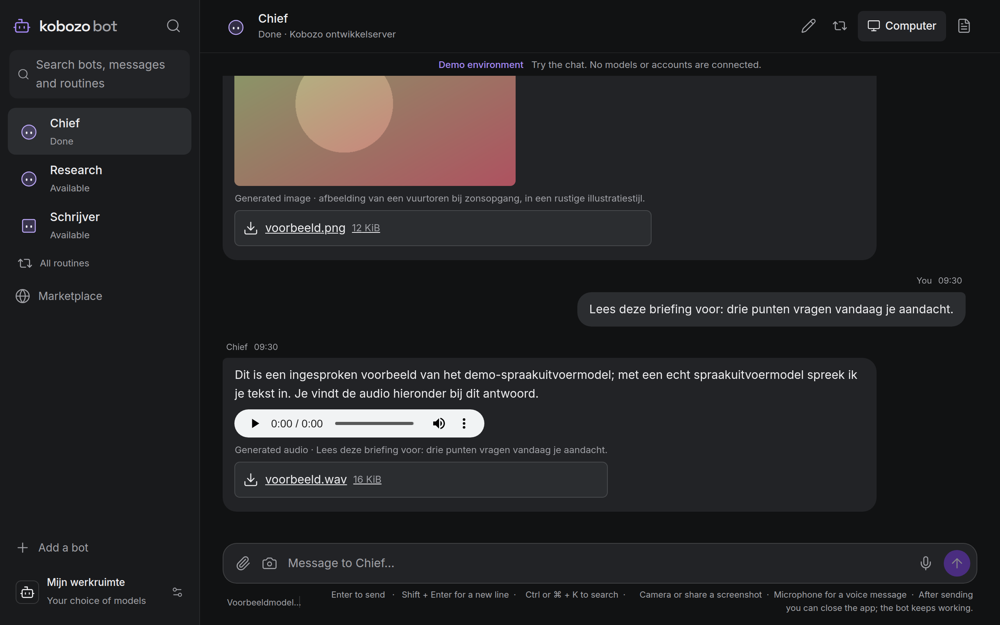
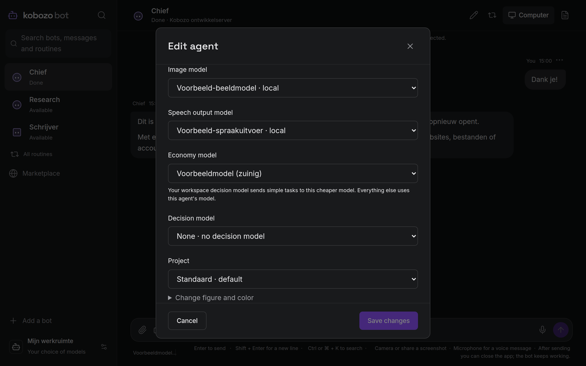
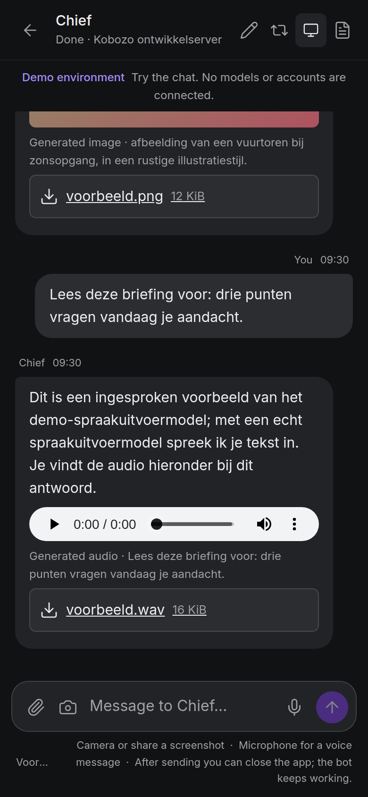
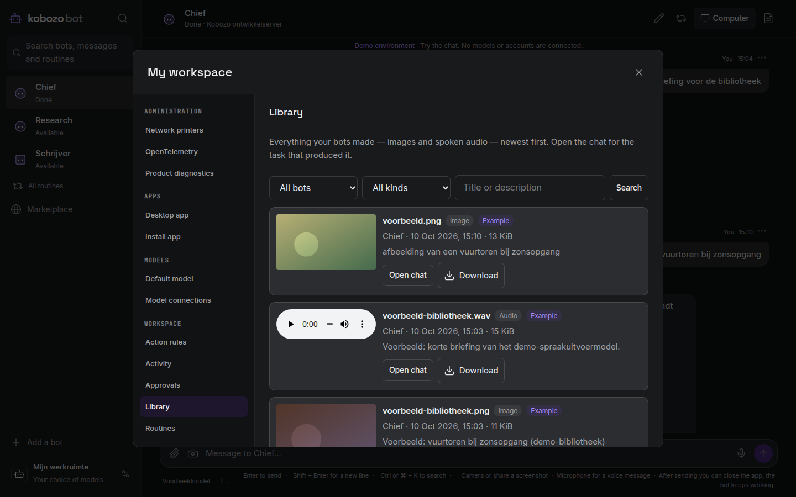
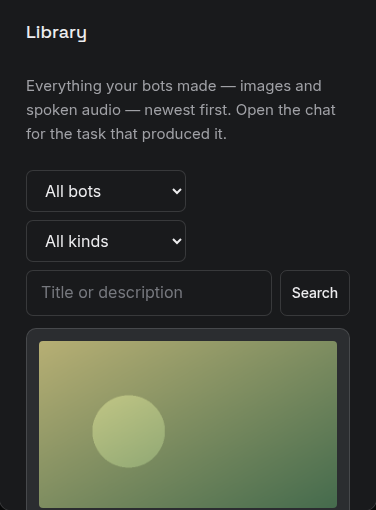

# Images and spoken audio

A bot can make an image or a spoken audio file when you ask for one in chat. It
does this only through a provider your administrator configured and you selected
for that bot. Nothing is generated through a hidden cloud account, and a bot
without a provider never tries a public website instead.

*Demo capture: Chief answers with an example image and an example audio file.
The demo providers are clearly labeled and produce synthetic output.*

## Choose the providers for a bot

Open **Edit agent** (the pencil beside the bot name). Below the bot's chat model
you find **Image model** and **Speech output model**. Each has a `None` choice.
Only image models appear in the first list and only speech-output models in the
second; chat models are never used to generate media.

*Demo capture: Chief with the demo image model and demo speech output selected.*

An entry marked *unavailable* is configured but not usable yet, for example
because its company key is missing. A workspace set to local models only shows
local providers only. Your administrator adds providers in the server model
configuration; the how-to for that lives in the server documentation.

## Ask for an image or audio

Ask in your own words: "Make an illustration of a lighthouse at sunrise" or "Read
this briefing aloud". The bot writes the prompt or the script, sends it to the
selected provider only, and the result appears under its answer with a download
link. Images show inline; audio has playback controls.

*Demo capture on a phone: the same task, with the audio player and download.*

A bot with no provider selected says so in one sentence and offers a written
alternative. It does not open a website or use another tool to work around it.

## Library

Open **My workspace → Library** (or the **Library** tab in **Details** on a bot, then **Open library**). You see
every image and spoken audio file your bots generated, newest first, across all
tasks. Filter by bot or kind, or search by title or description. Open the chat
that produced an item, or download the file. A generated image appears here as
soon as the bot finishes making it — you do not save it manually.

*Demo capture: labeled example image and audio in the account Library. Demo items
are marked Example and live only in demo storage.*

*The same page on a phone-sized screen.*

Files you attach yourself stay on the chat message and are not listed here.
Documents and Teach exports are not in the Library yet.

## Limits

- A generated file is at most 4 MiB; a task makes at most four files; each user
  keeps at most 64 MiB of generated media. Above a limit the bot reports it.
- Spoken audio is one voice reading a script of up to 4000 characters. A
  two-host production is not assembled for you.
- Generated files stay with the task in that bot's chat and also appear in the
  Library for that account.
- Generated files are not searched, not forwarded to colleagues and not placed on
  a bot's computer.
- Demo mode makes an example gradient image and a short chime, so you can try the
  flow without an account. They are examples, not model output. The demo Library
  starts with two labeled example rows in its own database.
