# My workspace

**My workspace** at the bottom of the bot list opens settings across the full
screen. On a wide screen, **Back**, the Personal / Organization switch and a
search field sit at the top of the left menu. The menu leads with what you
open often: your account, then the workspace (projects, routines, skills,
approvals and the rest of the daily work), then models. Pages you open once
in a while are folded under **More**: billing, and **Apps** (the desktop app,
installing the phone app, notifications and computers). The overview is a workspace mark and a grid of tiles for the pages you open
often. Each tile names the page and what it is for. **Less often** stays
closed until you open it. Every page after that sits on its own sheet under
the title, with one line that says what the page is for.

On the web, an administrator switches between **Personal** and **Organization**.
On a narrow screen that switch stays at the top of the page. Organization settings cover users, backups, sign-in,
company model keys, the project environment (inbound webhooks and channels),
the default for new workspaces, diagnostics, OpenTelemetry, network printers
and server updates. A member only sees personal settings. In the Mac app those
organization pages are not shown. **Organization settings** opens the system
browser at `/settings/organization` on your server, without a session token,
so you sign in on the web.

The left menu scrolls when the list is longer than the window. **Sign out**
stays at the bottom of that column. On a narrow screen the sidebar becomes a
section menu in the same order, and forms stack so fields stay full width.

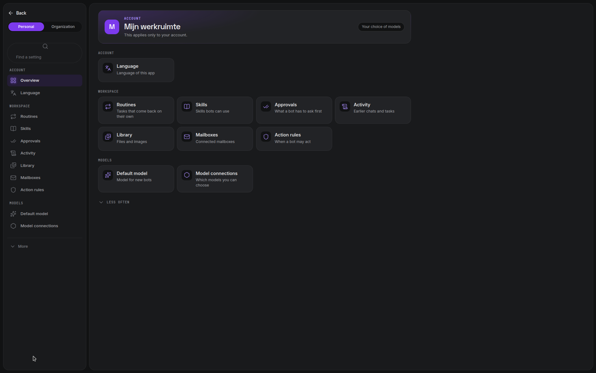

*Demo capture: personal settings fill the screen. The menu and the page sit
in separate rounded panels. Everyday pages are tiles. Apps stay under More
and Less often.*

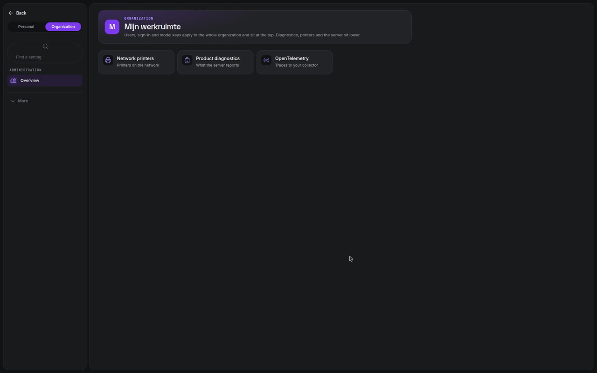

*Demo capture: the same screen after switching to organization settings.
The workspace mark stays, and the tools this demo can show sit as tiles.
Members do not see this switch. The Mac app opens this page in the browser.*

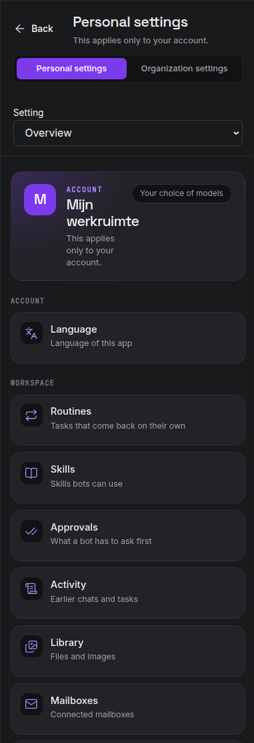

*On a phone-width screen the sidebar becomes a section menu. Tiles stack in
one column. The scope switch stays on one row under Back.*

## Library

**Workspace → Library** lists images and spoken audio your bots generated,
newest first. Filter by bot or kind, search by title or description, open the
source chat or download the file. Output lands here as soon as a run saves it;
there is no separate save step. Files you upload yourself stay on the chat
message. See [Images and spoken audio](media.md#library).

## Activity

**Workspace → Activity** lists what your bots did, newest first: chat tasks,
routine runs and help one bot asked from another. Each entry shows the bot,
what was asked, whether it finished, failed or was stopped, and when. Open an
entry to see the steps it took, the decisions it asked you for, what helper
bots were asked and answered, and the final answer. Filter by bot or by kind.
**Details → All activity** on a bot opens the same list.

History lasts as long as the conversation. Clearing a conversation or deleting
a bot also clears its history. Steps show which action ran, not its input.

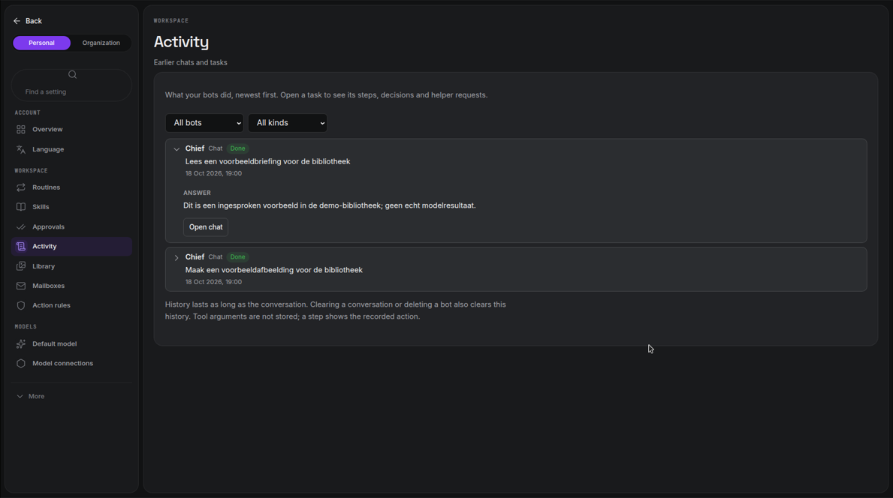

*Demo capture: a demo chat task opened to its answer, on the sheet under the
page title. Demo has no live models or integrations, so it records no tool steps.*

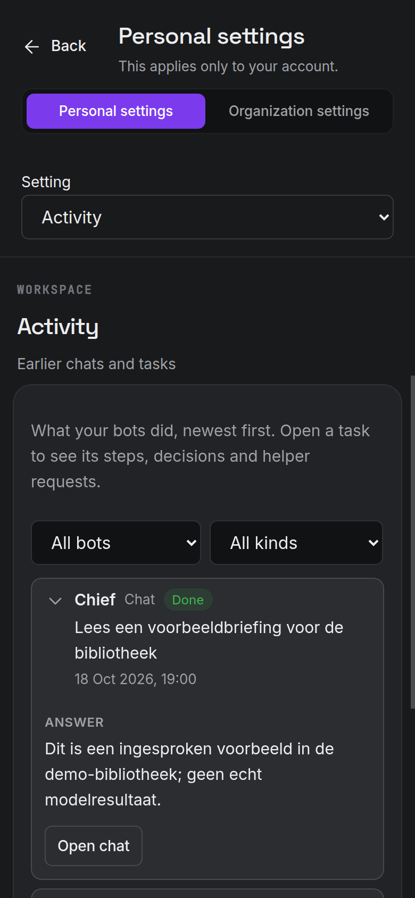

*The same page on a phone-sized screen. The list sits on a sheet under the title, with a demo chat opened to its answer.*

## Approvals

**Workspace → Approvals** shows what you agreed to and what you refused, in one
place:

- **Connected accounts**: each integration account, whether it is connected and
  which sandboxes may use it. **Disconnect** removes the stored sign-in; a task
  that still needs it gets an error instead of continuing silently. Change
  sandbox access in **Integrations**.
- **Action rules**: opens your [action rules](integrations-and-routines.md#action-rules-and-approvals).
- **Sign-ins and lessons**: protected sign-ins and Teach lessons your bots keep,
  by name only. Remove them under **Computer → Teach** on that bot.
- **Decisions**: approved and declined actions, questions, model evolutions,
  sign-ins, settings requests, integration authorizations and computer
  takeovers, newest first, with the bot that asked. Filter by outcome.

The page never shows passwords, tokens or integration addresses. You only see
your own bots.

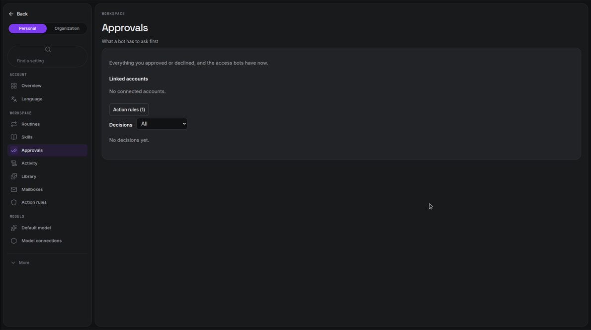

*Demo capture: the page sits on a sheet under the title. This demo has no
connected accounts and no decisions yet. The outcome filter sits beside
Decisions.*

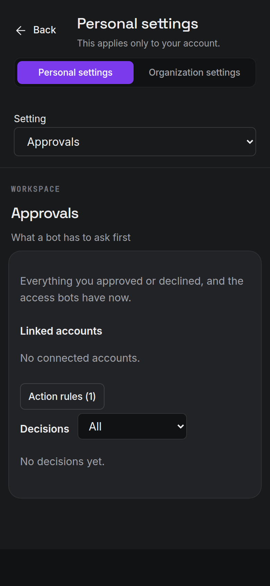

*The same page on a phone-sized screen. The outcome filter sits beside Decisions. This demo has no decisions yet.*

## Account and sign-in

On a real server you sign in with email and password. Passkeys, Google and
GitHub are optional after an administrator configures them. Linked methods open
the same bots and projects. The browser session stores only the app token, not
model keys.

An administrator turns an account off under **My workspace → Users**. That
signs the person out, stops their queued and running tasks, and pauses routines,
webhooks and Telegram links that were switched on. Turning the account back on
does not start that work again. The same Users page lists what was paused.
**Resume** starts one item. **Resume all** starts every item that was on. A
routine's next run is the next time from now, not the runs that were missed.
A webhook call that was still waiting is dropped and is not sent after resume.
Resume all also refuses a writable webhook that has no signing secret.
A routine or Telegram link the person had already switched off stays off.

### Local install: no login by default

On a local install (one person on one computer, no Proxmox) there is no login
screen. Kobozo Bot opens straight into your workspace, and the organization
pages (Users, Backups, Model keys, Server and version) and the Proxmox
installation wizard do not exist because there is no team. Your own model
keys stay under **Models**.

**My workspace → Password** has the switch **Ask for a password when starting**.
Turning it on asks for your email address (it becomes your username) and a new
password of at least 12 characters; from then on the login screen appears.
Turning it off asks for your current password and returns to opening without a
login. You cannot turn the password off while the server is also reachable from
outside this computer; the app says so.

Without a password, anyone who uses this computer, including other operating
system users, can open the app and use your bots, files and linked accounts. Set
a password on a shared computer.

## Models

The first account on the server is the administrator. If you are the only user,
that is you: you add models yourself. You do not wait for someone else.

Each bot has one configured model, and optionally a cheaper economy model for
simple tasks (see [decision models](decision-models.md#cheaper-model-for-simple-tasks)). Set a personal default under **Models →
Default model**. **Model connections** lists what is already configured; it does
not open a key form. Company keys live under **Administration → Model keys →
Company keys**. Personal keys are allowed only when you (or another
administrator) permit them. There is no silent cloud fallback: a run uses the
model you configured.

When your server has a decision model (Jev or LAYA), **Models → Default model**
also shows **Workspace decision model**. With one selected, the server makes
small, fast judgments with it instead of an extra chat-model call. After a
task it checks whether your message contains anything worth remembering, and
skips the memory review when it clearly does not. Details then shows **Memory
review skipped: nothing lasting in this message**. When in doubt, or if the
decision model fails, the normal review runs. It also helps bots rank
colleagues by role before they delegate a task; when the ranking is unclear,
the bot asks you. It suggests a model for a new bot instead of an extra
chat-model call. And it gives advice on actions that wait for your approval;
that advice never decides for you. Choose
**None** to switch it off. See [Decision models](decision-models.md).

Apps such as Gmail are separate from model keys. Ask your bot in chat to connect
them through MCP, or open **Integrations**. A normal IMAP mailbox is separate
again: open **Mailboxes**, save the host and app password on this server, and
the bot can read, search, draft and send. See
[Integrations and routines](integrations-and-routines.md).

### Bring your model

**Model keys → Company keys** shows one card per provider, grouped by how the
connection works. Cards sit two to a row with a visible border so they read as
buttons. Linked providers get a green check and sit in **Connected providers**
at the top of the list; the rest stay grouped below. Open a card to work on
that provider only; **Save** or **Cancel** returns to the list. The list itself
is not a scrolling form.

- **Native vendor API**: OpenAI, Anthropic, Google AI, Mistral AI, xAI (Grok),
  DeepSeek, Groq, Cohere, Together AI, Fireworks AI, Cerebras, Perplexity,
  DeepInfra, Azure OpenAI and Amazon Bedrock. Paste the platform API key from
  that vendor; the provider screen links to the page where you create one. Azure and
  Bedrock also ask for your own endpoint, because those live in your cloud
  subscription.
- **Vendor with an OpenAI-compatible API**: Moonshot AI (Kimi), Z.ai (GLM),
  Alibaba Model Studio (Qwen) and MiniMax. The vendor endpoint is prefilled;
  you paste the key. Models are listed from that account, or added by hand.
- **Gateway**: OpenRouter or LLM Gateway (llmgateway.io), one key for many
  brands. **Test** and **List models** ask the gateway which models it offers;
  the newest 100 text models are kept. Add any other model ID by hand.
- **Local servers**: Ollama, vLLM, LM Studio and llama.cpp. Enter the private
  address of the server (localhost or a LAN IP); a key is optional. The
  server lists whatever that machine currently serves. If listing is empty,
  add the exact served name by hand. A model id the product has retired does
  not appear in this list, even when the server file, `KOBOZO_MODELS`, or the
  model server still names it. Adding that id by hand is refused. A bot that
  already saved it keeps that choice until you pick another model.
- **Decision models**: TypeSafe (Jev, online API key) and LAYA (your own
  on-prem server, local address only). These give bots typed judgments, not
  chat; see [Decision models](decision-models.md).
- **Other**: any endpoint that speaks the OpenAI chat-completions protocol.

On the provider screen, **Save**, **Test**, **List models** and **Remove** ask
for your administrator password again, because a company key is shared with
everyone on this server. After a successful save or remove you return to the
cards. **Test** lists models from exactly that connection. **List models**
refreshes the discovered set; hand-added IDs stay. Personal keys under
**Model keys → Personal keys** accept the same cloud providers; users then add
their own API key under **Personal settings → Model connections**. Saving an
API key lists the models on the account, and they show up next to the company
models. **List models** fetches the list again. **Allow personal model keys**
and **Users may add their own model connections** sit at the top of that
policy, above the provider list, so they stay on screen instead of hiding
under **Save policy**. The long provider list and **Save policy** scroll with
the rest of the form.

Use an API key. Anthropic’s legal and compliance page says: “Anthropic does
not permit third-party developers to … route requests through Free, Pro, or
Max plan credentials on behalf of their users.” The same page says third
parties may not collect, store, or intermediate Claude.ai credentials or
session tokens, and that Anthropic may enforce this without prior notice.
See [Legal and compliance](https://code.claude.com/docs/en/legal-and-compliance).

A sign-in method the provider marks this way is not a company key, and it
stays hidden from personal keys. It is not used to list models or to chat.
An administrator can turn it on under **My workspace → Model keys → Personal
keys** with **Allow sign-in methods that may conflict with provider terms**
(Nederlands: **Aanmeldmethoden toestaan die de voorwaarden van een provider
kunnen schenden**). The switch is off by default. Saving the policy asks for
the administrator password again, and the page shows how many users still
have such a method saved. When the switch is on, the method appears with that
warning, a link to the provider’s terms, and an **I understand** tick
(**Ik begrijp het**).

A token saved before this rule stays encrypted. While the switch is off it is
not used. The model row says to add an API key, and **Add API key** opens the
API-key form. **Remove** still deletes the saved token. Turning the switch on makes a saved token usable again right away. The I understand tick is asked when someone saves a new token. A chat whose only credential is that method stops before the model
call and shows the same message. Kobozo does not switch to another provider.

The provider does allow an end user to sign in to its own unmodified Claude
Code program with a subscription, including when a platform hosts that
program. Kobozo does not run that program. That would be a separate feature.

When users may add their own model connections, saving a personal API key
lists the models that key can reach and opens **Add model**
with them in **Available models**. Pick one to fill the model ID and display
name. **Fetch available models** refreshes the list later. If the
administrator limits model names, only those appear. A provider without a
model list still accepts a model ID typed by hand.

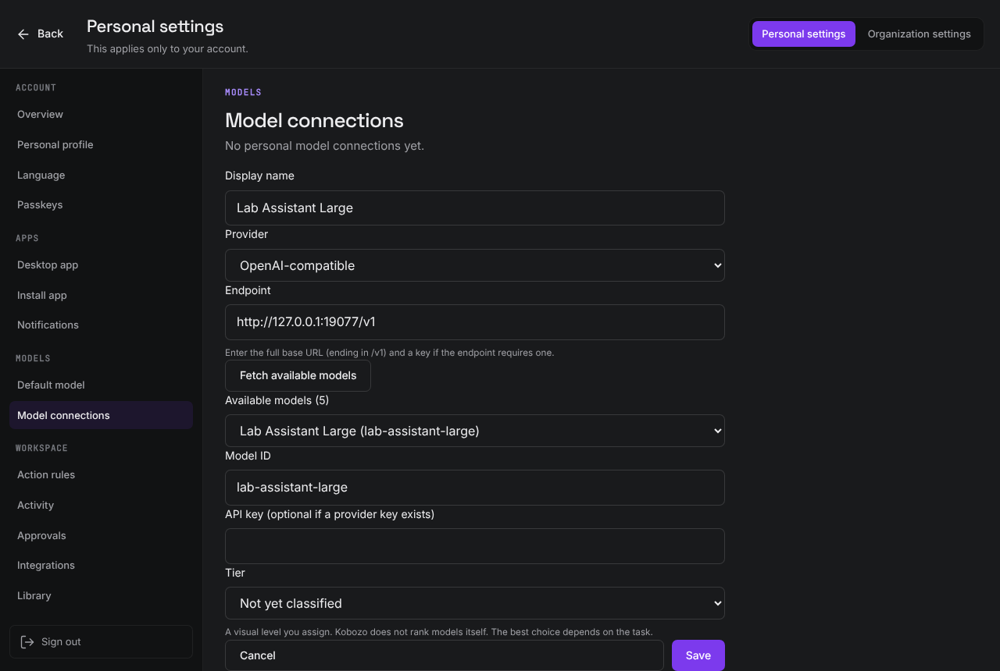

*Lab capture: a personal key for an OpenAI-compatible test endpoint lists
five models. Picking one fills the model ID and display name.*

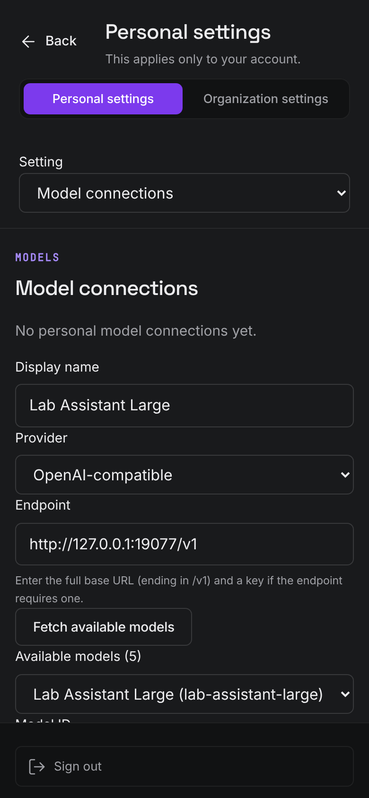

*Lab capture: the same list on a phone, under Model connections.*

Each model on a company connection has a **Tier** menu: Not classified, or
levels 1 to 4. The labels are Compact, Versatile, Advanced and Flagship. This
is a visual mark on the bot figure. Kobozo does not rank models, and the best
choice depends on the task. Saving or clearing a tier asks for the administrator
password again. Clearing returns the model to Not classified. The tier menu
stays unavailable until that connection is saved; a connection that has only
been tested is not stored, so its models cannot be classified yet.

Chat works as soon as the model is listed. **Own desktop** is a separate
checkbox on that same row. Turn it on only after you have checked that the
model can read screenshots and call tools. From the next task, a bot on that
model receives Chrome, files and screen control on the LXC of its own project.
Leaving it off keeps chat and does not open that desktop. Listing models again
keeps the checkbox as you set it. Decision models have no checkbox: they never
drive a desktop. Saving asks for the administrator password again.

Personal models have the same menu under **My workspace → Models**, both when
you add a model and on each model you already saved.

A model an operator set in the server configuration file stays read-only and
says it is set in server configuration. A model with no tier shows Not
classified, and the figure stays neutral until someone sets a level.

A screenshot of the tier menu is still pending. Demo mode does not open the
administrator Model keys pane, so this page does not invent one.

The same provider list appears in the setup wizard's **Models** step and, for
`models.local.json`, in the server documentation.

Models you connected in the setup wizard also end up here once setup is done,
so every company model is in one place and can be removed. The server lists
the endpoint again at that moment: a model it no longer serves disappears, and
bots follow the moved models automatically. If the endpoint was unreachable,
the model shows as hand-added so you can keep or remove it. A wizard model
stays where it is when this list would treat it differently, for example a
private-network server added as **Other** in local-only mode, or when you had
already saved a different key for that provider that does not serve it.

A dedicated screenshot of the Model keys cards and the provider editor is still
pending from a lab install. Demo mode does not show this administrator pane.

## Backups

Administrators open **Backups** to choose where nightly copies go, see the last
result, download the recovery kit, and run a restore test. After the first
save, the same page still edits the destination, schedule, retention and
monthly reminder. A red warning stays
on the admin home when backup setup was skipped or a backup failed. A backup
server encrypts the whole image. On that server Kobozo can add backups and does
not prune them. Deleting and pruning are blocked when the backup user there has
the DatastoreBackup role. The server’s own prune job keeps 7 daily and 4 weekly
copies. The page says add-only is not verified until an administrator confirms
that the backup user, the datastore ACL and that prune job are set on the
backup server. That protection is not possible on a network share or USB disk.
The nightly job and Back up now use Kobozo's own retention. On a backup server,
Kobozo's own job keeps all copies and the server's prune job removes old ones.
Other backup jobs on that storage are not changed. On a network share or USB
disk, both the nightly job and Back up now prune with the saved daily and
weekly counts. If an earlier version set keep-all on the storage, the page
shows a one-time notice after the next start, without saving again, and Kobozo does not change that storage setting back.
Dismissing it applies to that storage. Another storage that is still keep-all shows the notice again.
If someone changed Kobozo's backup job in Proxmox, **Back up now** asks you to save the destination again.
A pool backup lists each guest when the task log names them, as succeeded, failed, warning or running. Otherwise the page shows the latest pool backup.
A pool backup that stops before its command line is logged shows that it needs attention when the error names this destination, or when it started at the nightly time and the error does not name a different storage. Another backup on the node does not raise that warning. It does not wait until 36 hours have passed.
A **Back up now** that stops the same way, such as a lock timeout, stays failed on the next check. It clears when a later backup finishes or you back up again.
An external database
restore needs a separate scratch database (`KOBOZO_BACKUP_SCRATCH_URL`) marked
with `kobozo-bot prepare-backup-scratch`. Another name for the application
database, such as localhost or a Unix socket, is refused. Otherwise the page
shows that the external restore was not verified. A network share or disk
encrypts the database and key files, and shows that the rest of the image is
not encrypted. A disk on the same machine is marked not off-box. An encrypted
database bundle older than 24 hours is marked on this page.

A screenshot of this page is still pending. This environment has no Proxmox
host, so the capture has to come from a lab install. The shots to take are
listed in `docs/backup-lab.md`.

## Server and version

Administrators open **Server and version** to see the installed version, the
channel and the newest version with its one-line notes. An update replaces the
orchestrator runtime and central catalogs. It does not rewrite existing agents,
project computers or credentials. **Update** asks for a second click to confirm.

- **Update channel** is **Stable** (the default) or **Beta**. Beta gets new
  versions sooner and takes the higher of the newest beta and the newest stable.
  Switching from Beta to Stable never downgrades: the server waits until a
  stable version is newer than the one installed.
- **Update automatically** is off by default. When on, the server checks every
  hour and installs a newer version of your channel by itself. It never runs
  while an update is already running and never goes back to an older version.
  The page shows the last check and its result.
- A server that does not run a released version (a lab build) shows
  **Unreleased**. It can be updated by hand but never updates itself.

Every release is signed. Before anything is installed the server checks the
signature against the keys it trusts, then the build revision, the size and the
checksums. A release that fails a check is refused with a short message and
nothing is downloaded or changed.

*Screenshot pending: the page with the channel, automatic updates and version
lines. It has to be captured from the real app (desktop and phone width).*

## Projects

**Workspace → Projects** lists the sandboxes you own. Each extra sandbox is a
separate computer. Public/Private is security between your own projects, not
exposure to the internet or other users.

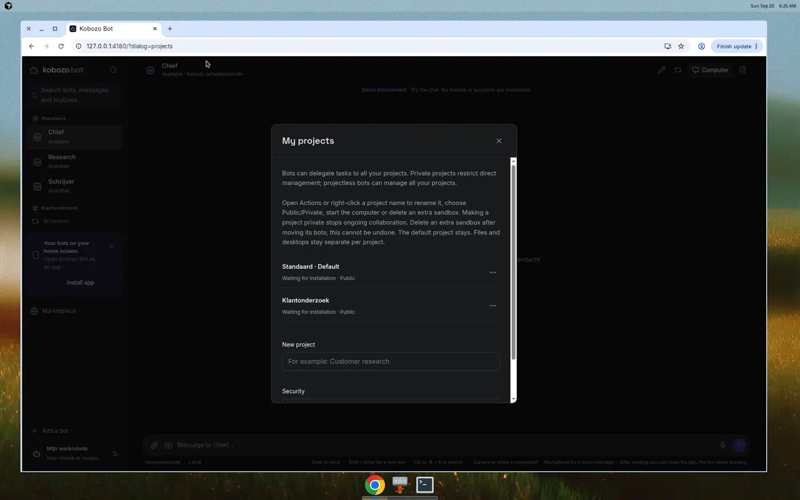

*Demo capture: one action button per project row. Open it or right-click the
project name for Rename, Security, Updates, Start and Remove. Security opens a
window to choose Public or Private. The default project has no Remove. Demo
hides live LXC hosting, so Start stays on waiting for installation.*

On a phone-width layout the name and action button stay on one line.

- Right-click an empty part of the team list and choose **New project** to
  create a sandbox without moving a bot. The same action is on an empty part of
  **Projects**.

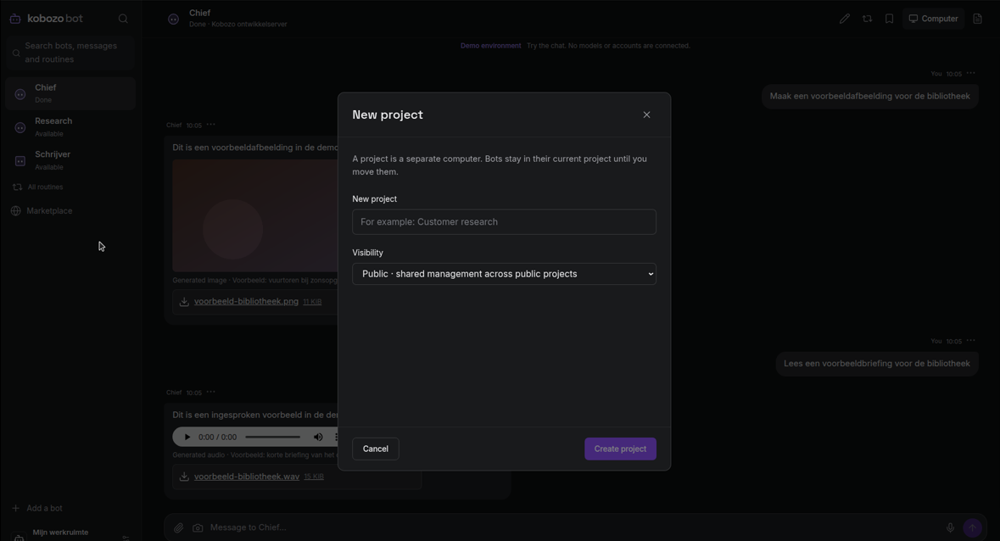

*Demo capture: **New project** from the team list. **Create project** adds the
sandbox and does not move a bot. Public means shared management with your other
public projects.*

- Open **Actions** (the ··· button) or **right-click a project name** — including
  the project heading in the team list when more than one sandbox exists.
- **Rename** changes the label in the team list and in chat tools.
- **Security** opens a window. Choose Public (shared direct management with your
  other public projects) or Private (direct management stays inside that
  project). The current choice is marked. Making a project private stops
  ongoing collaboration. Bots can still send a bounded task to a colleague in
  another of your projects.

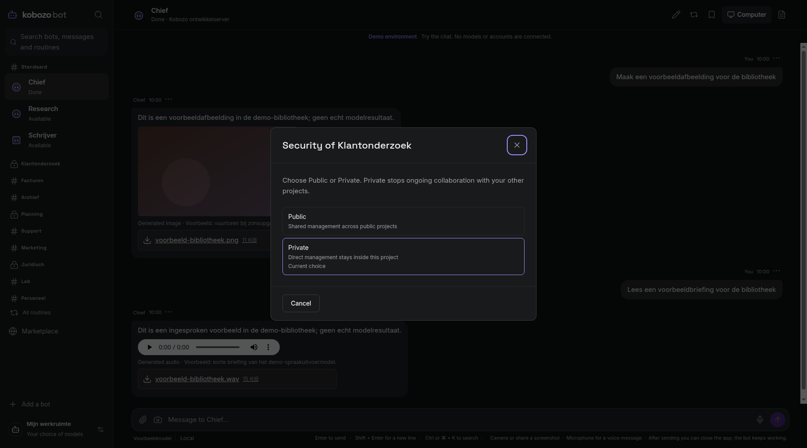

*Demo capture: Security opens its own window. Private is marked as the current
choice. Public and Private are not extra rows in the context menu.*
- **Delete** removes an extra sandbox and its computer. Move or delete its bots
  first. This cannot be undone. The default project cannot be deleted.

The demo hides live project hosting, so extra LXC IDs and start/stop may be
absent there. On a real install, status shows whether the computer is starting,
ready or stopped.

## Routines

**Workspace → Routines** is the same cross-bot list as **All routines** on the
bot list. It does not replace the repeat control beside **Computer**, which
still creates and edits one bot’s schedules.

## Skills

**Workspace → Skills** is the library of methods you own. Each skill applies to
every bot, to one project, or to one bot. A method for a guided teammate stays
on that bot. **Skill from git** copies `SKILL.md` text from a public GitHub
link you choose. See [Skills](skills.md). Screenshot of this pane, including
the git form, is still pending a real app capture.

## Diagnostics and OpenTelemetry

Product diagnostics can send fixed event codes to Kobozo, without chat or
account contents. Turn them off under **Product diagnostics**. Organization
OpenTelemetry export is optional and installation-wide.

## Network printers

Administrators open **Network printers** to allowlist office IPP/IPPS printers
for bot desktops on this installation. When enabled, computer-capable bots can
print files from `/workspace` with `computer_print`. USB printers on your own
laptop are not listed here. See [Computers](computers.md).
